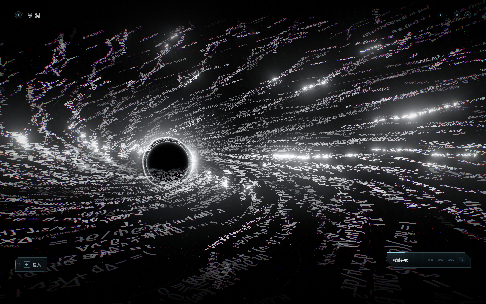
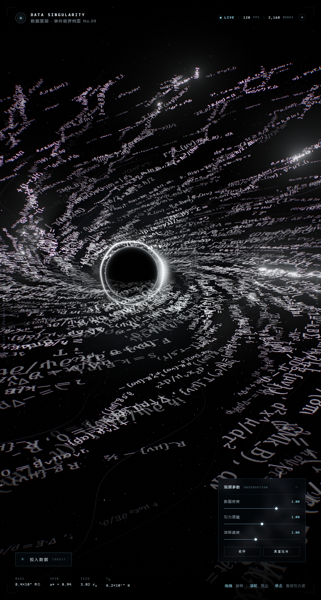
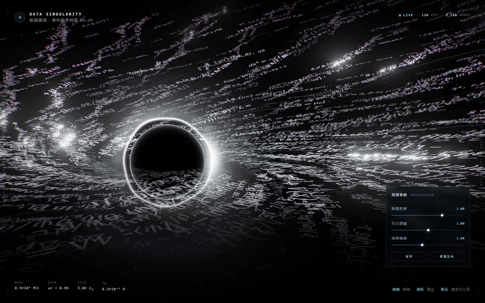
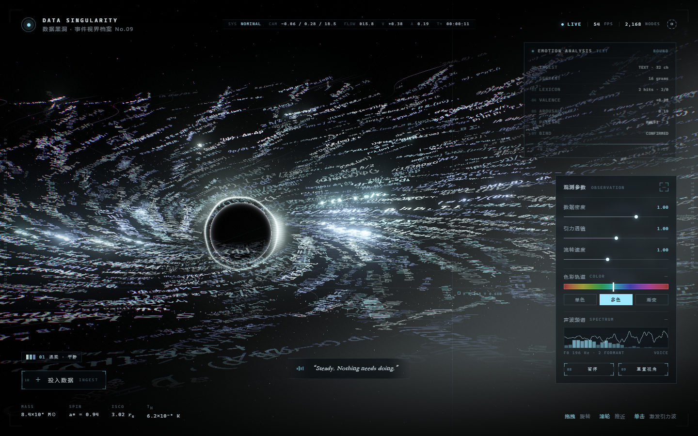
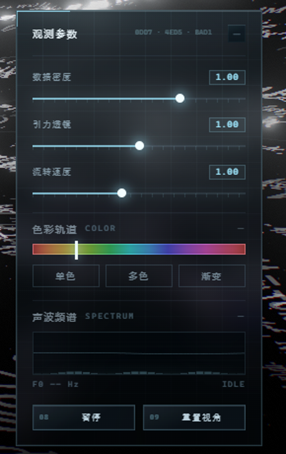

# DATA SINGULARITY · 数据黑洞

用「数据」建模的黑洞：视界之外没有气体、没有光——只有一层层数学公式、尘埃粒子与光纤维，沿着各自的流线**真正地坠入**奇点。





---

## 打开

**方式 A · 直接双击**

双击 `index.html` 即可。所有依赖都已打包进 `app.js`（含 three.js），不需要服务器、不需要联网。

**方式 B · 本地服务器**

```bash
python -m http.server 8866
# 打开 http://127.0.0.1:8866/
```

> 推荐 Chrome / Edge / Safari 最新版。需要 WebGL2。

---

## 交互

| 操作 | 效果 |
| --- | --- |
| **拖拽** | 环绕黑洞自由旋转（带阻尼、松手后滑行） |
| **滚轮** | 推近 / 拉远（9 – 40） |
| **单击** | 引力波：亮度波前扫过数据面，并**短暂加速坠落** |
| **双击** | 回到默认机位 |
| **空格** | 暂停 / 继续 |
| 右下 **观测参数** | 数据密度、引力透镜强度、流转速度 |

---

## 数据是怎么被「吸进去」的

这不是整盘刚性旋转。每个公式块只保存 `(通道角, 种子, 相位)`，位置/切线/法线每一帧都在顶点着色器里按**当前半径**重算：

```
τ  = fract(phase + t / life + laneOffset)
r  = rOut − (rOut − rIn) · τ          // 匀速向内坠落
φ  = ψ + K·ln(r/rIn) + Ω(r)·t         // 沿对数螺旋下滑，内圈角速度更快
```

- 数据块沿自己的螺旋流线**一路向下滑**，越靠近视界角速度越大、被拉长（tidal stretch），到 `r ≈ 1.16` 被视界吃掉（淡出）；
- 同时在**外缘重生**（淡入），所以数据面始终维持同样的密度，但每一块都在动；
- 每条通道有独立的相位偏移，避免整片数据“一起跳”；
- 点击画面时 `uFlow` 会短暂加速，肉眼能看到数据被吸得更快。

---

## 数据链：一段一段，但读起来是一整句

不是「很多互不相干的短公式」，而是**长链**：

- 图集里是 8 段「长命题」，每段由若干公式用逗号连成一句（例如 `R_{μν} − ½Rg_{μν} + Λg_{μν} = (8πG/c⁴)T_{μν} , ∇^μT_{μν} = 0 , R − 4Λ = −8πG T`）；
- 每段命题先画成一整条 4096px 的长条，再**切成 8 个连续片段**存进图集；
- 一条通道按片段顺序 0→1→…→7 铺下去，相邻方块首尾相接，于是**拼回完整的长句**，结尾自然接到下一段命题——像一段连续的数据流，而不是一条条断句。

**长短不一**：约 70% 的通道是贯穿整盘的连续长链；22% 断成 6–16 块的中等数据段；8% 是 2–6 块的短促数据簇（中间留空）。三种节奏混在一起，画面才有疏密。

---

## 其余结构

### 视界 · 光子环
纯黑球体 + 极薄菲涅尔边缘；光子环是不规则的亮环（角向抖动、单侧多普勒增亮、极细核心 + 柔晕）。合成时在视界的屏幕圆内遮掉 bloom，保证内部是绝对的 0 亮度。

### 曲面与光
- 曲面高度 `bowl·t^1.7 − tilt·t²·sinφ + ripple`，外缘翘起，数据面像被引力拽弯的碗；
- 36 条高光纤维 + 46 条细线沿同一条流场坠落，形成长曝光式的拖痕；
- 焦散的明暗带随流场扫过，数据会「反光」。

### 粒子与星空
11 000 颗吸积尘埃同样按半径差速坠落，16 000 颗星带轻微闪烁与色温差异。

### 后期
自建 HDR 管线（无后期库）：

```
scene → HalfFloat RT
      → bright pass → 6 级 mip 降采样 → tent 上采样
      → 色调映射 / 冷调 / 暗角 / 胶片颗粒 / 轻微色散 / 视界遮罩
```

DPR 上限 1.7，掉帧自动降档。

---

## 目录

```
data-singularity/
├─ index.html            页面结构 + HUD
├─ app.js                打包产物（three.js + 场景），index.html 直接引用
├─ assets/
│  ├─ style.css          HUD / 启动动画 / 响应式
│  └─ main.js            场景源码（ES Module）
├─ vendor/three.module.js
├─ build.cjs             node build.cjs → 重新生成 app.js
└─ preview/              截图
```

### 可调参数

`assets/main.js` 顶部 `F`：

| 参数 | 含义 | 默认 |
| --- | --- | --- |
| `rIn` / `rOut` | 数据面内外半径 | 1.66 / 24 |
| `flowIn` | 被吞噬的半径 | 1.16 |
| `lanes` | 通道（链条）数量 | 112 |
| `pitch` | 螺旋扭转 | 1.02 |
| `bowl` / `tilt` | 曲面翘起 / 前后倾斜 | 6.0 / 2.6 |
| `life` | 从外缘坠到视界的秒数 | 38 |
| `spin` | 差速旋转速度 | 0.9 |

URL 覆盖，方便调构图：

```
index.html?lanes=150&pitch=1.4&cp=0.34&cd=16&sx=0.18
```

（`cp` 俯仰、`cy` 偏航、`cd` 距离、`sx/sy` 画面偏移）

---

## 情绪摄取 · EMOTION INGEST

双击 `index.html` 后先看到迎宾页。点「进入视界」会播放一段用 Web Audio 实时合成的迎宾音（低频涌起 + 三音钟 + 长混响，J.A.R.V.I.S. 那种「上线」的感觉），随后镜头推进、HUD 浮出。

左下角 **＋ 投入数据** 打开摄取面板：

- **文字**：粘贴任何文字（日记、歌词、评论、代码注释）。内置中英情绪词典，按分词命中、否定词、程度副词、感叹号/省略号计算 **效价 V**（−1…1）与 **唤醒度 A**（0…1）。
- **图像**：拖入任意图片。本地取 72×72 像素做色相/饱和度/亮度/对比度与主色统计，用暖度与明度推出 V/A，并直接采用图片的主色作为调色板。

解析过程会在右上角走一条**实时流水线**：

```
01 INGEST 摄取   → 02 SEGMENT 切分 → 03 LEXICON 词典 → 04 VALENCE 效价
05 AROUSAL 唤醒  → 06 PALETTE 色彩 → 07 BIND 绑定
```

每一步都有数值、进度条、音效与一次视界脉冲；结束时整片数据面被染色，同时出现一道扫过全屏的**光带转场**与低频轰鸣。

### 颜色

三种模式由情绪自动选择，也可点档案里的色块重新投入：

| 模式 | 触发 | 效果 |
| --- | --- | --- |
| **单色 mono** | 情绪偏负、唤醒中等 | 整片同一色相，靠明度分层 |
| **多色 multi** | 情绪中性、唤醒中高 | 同色系 2–3 个色相，链条间错色 |
| **渐变 gradient** | 唤醒度高（愤怒/剧烈） | 从视界到外缘连续过渡 |

色相由情绪类型决定：喜悦 42° / 平静 188° / 愤怒 8° / 忧郁 228° / 紧张 288°。饱和度与明度取自唤醒度与正负性。数据、尘埃、光子环、光纤维、泛光全部一起染色。

档案会保留最近 4 次解析（左下角色卡），点击即可回到那次情绪。

> 所有分析都在本机完成，不上传任何内容。音效可用右上角 ◑ 开关。
---

## VOICE · 她的声音

界面不再使用核能/机械音效，所有反馈让位给一个声音：一位成熟、克制、略带数字混响的英式女中音。

- **选音**：优先 en-GB 女声（Libby / Sonia / Hazel / Serena / Kate …），pitch 0.94、rate 0.82，语速舒缓；
- **底噪**：说话前后有一层 0.7s 的气声（bandpass 900→2400Hz）与两个低音垫（196 / 294Hz），形成“频道打开”的滤波混响感；
- **迎宾**：“You are welcome.” 之后接一句 “All systems are nominal.”；
- **按结果播报**：解析完成后从该情绪的词库里**随机**挑一句，例如
  - 平静 — “Quiet. I have given it blue.”
  - 愤怒 — “Heat. I have let the red in.”
  - 忧郁 — “Something heavy here. Deep blue.”
  - 图像 — 有 45% 概率追加 “The palette came from the image itself.”
- **字幕**：底部会淡入她刚说的一句（斜体衬线 + 声波点），静音时也能读；
- 按钮只剩一声极轻的玻璃“嗒”（0.012 增益），没有爆炸、没有轰鸣。

---

## VOICE 2 · 54 句词库 / 色彩轨道 / 声波

**只在点击后发声，且不频繁。** 迎宾一次，解析完成一次，其余点击只有一声极轻的玻璃“嗒”，不会连续播报。

声库共 **54 句**：
- 8 种情绪 × 5 句（喜悦 / 平静 / 愤怒 / 忧郁 / 紧张 / 冷静 / 温暖 / 暮色）；
- 5 句随机开场（Read. / Done. / It is in. / I have it. / As you asked.）；
- 4 句图像专属（The palette came from the image itself. …）；
- 5 句迎宾（You are welcome. / Welcome back. / Good to see you. …）。
- 28% 概率加开场、50% 概率给图像加尾句、16% 概率加 “Holding it here.”，组合起来有数百种可能。

调节面板里新增两个可折叠模块：

- **色彩轨道 COLOR**：一条全色相轨道，拖动即换色；下面是 `单色 / 多色 / 渐变` 三种映射方式。解析完成后轨道会自动跳到该情绪的色相。
- **声波频谱 SPECTRUM**：真实分析器（AnalyserNode）画出的波形与频柱；她说话时会进入 VOICE 状态，显示 `F0 196 Hz · 2 FORMANT`。


---

## UI 玻璃化 / 数据爬取链

- 面板、弹层、按钮全部改为**半透明玻璃**：`backdrop-filter: blur(16px)` + 顶部 1px 内高光 + 内阴影 + 26px 工程网格；
- 每 11 秒有一道**斜向扫光**掠过面板；
- 面板左上角有一条发光**定位线**（L 形角标），与按钮四角括号同一套语言；
- 标题右侧是**数据爬取链**：三组十六进制 / 二进制数字每 220ms 轮替滚动，显示为 `8A1F · 02C4 · B9D`；
- 数值改成**读数芯片**（`1.00` 带描边底色），滑杆带刻度与发光滑块；
- 按钮悬停时有一道**扫描光**从左扫到右，编号与四角括号保持；
- 顶栏 LIVE 增加了**信号柱**动画，系统遥测行加了玻璃底。


---

## 2026 · 切角形态 / 分析面板 / 文字注入

**切角**：面板、弹层、按钮、色卡不再是方框——统一切成 6–20px 的斜切角（`clip-path`），保留四角括号与内高光，方框感被削掉。

**分析面板**（左侧，与右侧调节面板对开）：投入数据后自动弹出，或把右侧面板折叠也会唤出。里面是：
- MOOD / V 效价 / A 唤醒 / HUE 色相 / MODE 映射 / TOKENS / HITS / INK 含字率；
- VALENCE 与 AROUSAL 两条**波动曲线**（带填充与端点）；
- 当前三色调色板色块。

**文字注入（约 20%）**：投入的文字不只是被分析——它会被切成 13 字左右的片段，画进图集的 8 行「墨迹区」，然后**替换数据流里每 5 个块中的 1 块**（20%），并用强调色高亮。所以你能在公式洪流里看见自己的句子在流动、被吸进视界。

- 每次投入都会往池子里追加片段（最多 120 段），池子越大，每句分到的格子越少，但整体含字量越多；
- 分析面板里的 `INK 20% · N FRAG` 就是当前池子的规模。
---

## 悬停锁定 / 极简迎宾

**悬停锁定（HOVER LOCK）**：鼠标停在数据流上，最近的那一条链会**立刻停住**（冻结它的坠落与旋转），其余数据照常流动、互不干扰；同时光标旁弹出 `TRACE 0x…` 卡片：

- 随机读取一种情绪（喜悦/平静/愤怒/忧郁/紧张/冷静/温暖/暮色）；
- 给出 V / A 数值与一句她从词库里随机挑的话；
- 移开光标淡出，继续流动。

实现：每 90ms 用与着色器相同的流场公式在 CPU 上重算 2 168 个块的位置并投影，取光标 42px 内最近的一条；把它的 `seed` 传给 `uFreezeSeed`，着色器里该链的 `flowT` 与 `time` 固定在锁定的那一刻。

**极简迎宾**：只留一个标记、标题、一行说明、一个按钮与 `SOUND ON`；去掉了副标题、进度条、状态行和多余字距。
**修订**：TRACE 面板只在**单击**某条数据链时出现（并冻结那一条），悬停/拖拽不会再弹出；点击空白处释放；点另一条会切换到那一条。

---

## 发布到 GitHub / GitHub Pages

**可以。** 这个目录就是完整仓库，`app.js` 已经是构建产物，克隆下来直接能跑。

### 提交什么

```
index.html  app.js  manifest.json  sw.js
assets/     icons/  preview/
vendor/     build.cjs
launch.ps1  黑洞.cmd  安装到电脑.bat  install.ps1  uninstall.ps1
创建快捷方式.cmd  手机安装.cmd
README.md   安装说明.md   LICENSE   .gitignore
```

- `黑洞.lnk` 已在 `.gitignore` 里——它保存的是本机绝对路径，不该提交；
- `preview/` 约 10 MB，只是 README 截图，想瘦身可以只留 `wide.png`；
- `assets/main.js` 是场景源码，`app.js` 是它 + three.js 的打包结果（`node build.cjs` 生成）。

### 上线（静态托管，一次配置）

1. 新建仓库，把本目录推到 `main`；
2. **Settings → Pages → Source: Deploy from a branch → main / (root) → Save**；
3. 约 1 分钟后访问 `https://<用户名>.github.io/<仓库名>/`。

所有路径都是相对路径，放在 `/仓库名/` 子目录下也能正常运行（已用子路径实测）。

**HTTPS 之后手机端才真正可安装**：Chrome 会给出「安装应用」，而不是只加一个快捷方式；Service Worker 也只在 https / localhost 下生效。

### 更新后看不到新版？

`sw.js` 是缓存优先的。改完内容后把第一行 `const CACHE = 'blackhole-v1'` 改成 `v2`，再 push，用户下次打开就会拿到新版本。

### 隐私

仓库里没有密钥、没有统计、没有外部接口；所有解析（文字情绪、图像取色）与语音合成都在浏览器本地完成。发布到公网后，访问者的输入也不会离开他的设备。
